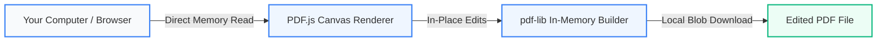

<div align="center">

# 📄 FreePDFEdit

**A lightning-fast, 100% private in-browser PDF editor with precision font matching and local AI text fitting.**

[](https://freepdfediting.netlify.app/)
[](https://react.dev/)
[](https://www.typescriptlang.org/)
[](https://tailwindcss.com/)
[](https://vitejs.dev/)
[](#-privacy-first-architecture)
[](LICENSE)

<br />

> **Zero uploads. No signup. No watermarks. Free forever.**  
> Everything runs strictly inside your web browser — your private documents never touch any server.

**[Launch FreePDFEdit → https://freepdfediting.netlify.app/](https://freepdfediting.netlify.app/)**

<br />

</div>

---

## ✨ Features at a Glance

| Feature | Description |
| :--- | :--- |
| **✍️ Precision In-Place Text Editing** | Click any line to edit text in place with smart horizontal line merging, alignment snap guides, background color sampling, and metric-compatible font matching (`Arimo`, `Carlito`, `Tinos`, `Cousine`). |
| **✨ Open-Source AI Smart Fit** | Integrates with local **Ollama** (`llama3.2`, `qwen2.5`) or offline semantic rules to rewrite overflow text into the line budget without shrinking font size. |
| **🔷 Vector Shapes & Annotations** | Draw ellipses, rectangles, lines, arrows, polygons, clouds, and polylines with stroke/fill/opacity/dash controls, plus 14 annotation icons with attachable PDF popup notes. |
| **🖼️ Image Insertion & Resize** | Add PNG or JPEG stamps/signatures, drag to reposition with alignment guides, and resize with aspect-ratio preservation. |
| **🖍️ Whiteout & Highlighter** | Redact sensitive areas or highlight key document passages. |
| **📱 Touch-Friendly Mobile Editor** | Dedicated View/Edit mode switcher, fit-to-width zoom, keyboard-aware bottom text sheet, and mobile canvas memory guards. |
| **💾 Local Draft Auto-Save** | Automatically saves active PDFs and edits locally in IndexedDB with draft recovery and unsaved-changes refresh confirmation. |
| **🛡️ Complete Offline Document Privacy** | Powered by WebAssembly and Canvas (`PDF.js` + `pdf-lib`). Your PDF files stay on your device at all times. |
| **🔄 Full Undo History & Instant Export** | Multi-step undo (`Ctrl+Z`), element deletion, and in-memory PDF export with embedded font subsets. |

---

## 🔒 Privacy-First Architecture

Most online PDF tools upload your sensitive bank statements, resumes, and legal contracts to remote cloud servers. **FreePDFEdit is different:**



* **Zero document uploads**: PDF parsing, rendering, editing, and exporting happen strictly inside your browser's memory.
* **No telemetry / trackers**: No document tracking or analytics profiling.
* **Works offline**: Disconnect your internet and edit/export documents without interruption. *(Optional serverless endpoints are used only when you explicitly submit feedback or trigger a Buy Me a Coffee UPI QR / thank-you email.)*

---

## 🧠 Open-Source AI Text Optimization

When editing dense academic papers or contracts, replacement phrases often exceed the line's available margin. FreePDFEdit solves this with an inline **AI Smart Fit Assistant**:

- **Local Ollama Support**: Connects directly to your local Ollama daemon (`http://localhost:11434`) using open-source models like `llama3.2` or `qwen2.5`.
- **Built-in Offline Engine**: Works out-of-the-box even without Ollama installed via an embedded semantic condenser.
- **Three Modes**:
  1. 🎯 **Smart Fit**: Tightens text length to fit the exact line boundary while preserving meaning.
  2. 🎓 **Academic Polish**: Elevates phrasing to formal scholarly English.
  3. ✂️ **Ultra-Concise**: Condenses paragraphs for compact layouts.

---

## 🚀 Quick Start

### Prerequisites
- Node.js 18+
- npm or pnpm

### 1. Clone & Install
```bash
git clone https://github.com/bmanish55/FreePDFEdit.git
cd FreePDFEdit
npm install
```

### 2. Run Development Server
```bash
npm run dev
```
Open [http://localhost:5173](http://localhost:5173) in your browser.

### 3. Build for Production
```bash
npm run build
npm run preview
```

---

## 🤖 (Optional) Connect Local AI with Ollama

To enable local LLM paraphrasing for the AI Smart Fit assistant:

1. Install [Ollama](https://ollama.com/).
2. Pull a fast, lightweight open-source model:
   ```bash
   ollama run llama3.2
   ```
3. Open any PDF in FreePDFEdit, click any text line, and click **✨ AI Fit & Polish**. It will auto-detect your local model!

---

## 🛠️ Tech Stack

* **Frontend Framework**: [React 18](https://react.dev/) + [Vite 6](https://vitejs.dev/)
* **Language**: [TypeScript 5.7](https://www.typescriptlang.org/)
* **Styling**: [Tailwind CSS v4](https://tailwindcss.com/)
* **PDF Parsing & Rendering**: [PDF.js (`pdfjs-dist`)](https://mozilla.github.io/pdf.js/)
* **PDF Generation & Binary Assembly**: [pdf-lib](https://pdf-lib.js.org/) + [@pdf-lib/fontkit](https://github.com/Hopding/fontkit)
* **Metric-Compatible Fonts**: Tinos (Times), Arimo (Arial), Carlito (Calibri), Cousine (Courier)
* **State & Local Persistence**: [Zustand](https://github.com/pmndrs/zustand) + browser `IndexedDB` draft storage
* **Optional Serverless Routes**: Netlify Functions / Vercel API (`nodemailer`, `qrcode`) for OTP feedback & UPI Buy Me a Coffee emails
* **Icons**: [Lucide React](https://lucide.dev/)

---

## 📚 Developer Guides

Reference architecture guides for future updates live in [`Guide/`](Guide/):

* [`Guide/TEXT_ENGINE_SPEC.md`](Guide/TEXT_ENGINE_SPEC.md) — Coordinate model, font metrics, color sampling, `layoutText` invariants, and future Devanagari/script support notes.
* [`Guide/MOBILE_SPEC.md`](Guide/MOBILE_SPEC.md) — Desktop/mobile branching rules, touch-scroll safety, `visualViewport` keyboard positioning, and iOS canvas pixel caps.

---

## 📝 Changelog

### 2026-11-12 — Support Flow Fix, Docs Cleanup & Netlify Config
* **Buy Me a Coffee Banner Fix**: Restricted the `"Anyway, thanks for using this app! Your PDF download has started..."` declined banner strictly to the PDF download flow (`coffeeSource === 'download'`), so cancelling from the footer no longer claims a PDF download started.
* **Netlify Secrets Scan Configuration**: Added `netlify.toml` with `SECRETS_SCAN_OMIT_KEYS` for public display names (`GMAIL_FROM_NAME`, `UPI_PAYEE_NAME`) while keeping private credentials (`GMAIL_USER`, `GMAIL_APP_PASSWORD`, `UPI_VPA`) protected.
* **Documentation Cleanup**: Moved reusable implementation guides (`TEXT_ENGINE_SPEC.md`, `MOBILE_SPEC.md`) into `Guide/`, removed obsolete step-by-step specs (`PROJECT_SPEC.md`, `DESIGN_SPEC.md`), and updated `README.md`.

### 2026-11-12 — Buy Me a Coffee & Serverless Support
* Added multi-step `BuyMeCoffeeModal` (download prompt & footer trigger) with preset/custom INR amounts, UPI QR code generation (`qrcode`), mobile `upi://pay` deep links, UTR confirmation, and Gmail SMTP / Resend thank-you & owner notification emails.
* Consolidated local Vite dev middleware, Netlify Functions, and Vercel API endpoints around shared handlers in `server/`.

### 2026-11-12 — Shapes & Annotations
* Added 7 vector shape tools (`ellipse`, `rectangle`, `line`, `arrow`, `polygon`, `cloud`, `polyline`) with customizable stroke/fill colors, opacity, stroke width, and line dash styles exported cleanly to `pdf-lib`.
* Added 14 PDF annotation icons (`comment`, `chat`, `pointer`, `arrow`, `check`, `circle`, `cross`, `insert`, `np`, `fileNote`, `paragraph`, `question`, `star`, `key`) with editable notes exported as PDF `/Text` popup annotations.

### 2026-11-11 — Text Editing & Alignment Enhancements
* Added smart same-line text fragment merging (`mergeText.ts`), alignment snap guides (`snapGuides.ts`), `TextObjectView`, and numeric `FontSizeInput` controls.
* Improved font loading, background color sampling, and multi-span cover bounds during PDF export.

### 2026-11-10 — Data Safety, Mobile Editor, Feedback & SEO
* **Data Safety**: Added IndexedDB draft auto-save (`draftStorage.ts`), draft restore prompt, and unsaved-changes refresh confirmation (`useUnsavedGuard`, `RefreshConfirmModal`).
* **Mobile Touch Editor**: Added View/Edit modes, fit-to-width zoom, `visualViewport` keyboard-aware `TextEditSheet`, touch gesture guards, and DPR / 12M pixel canvas memory caps.
* **Verified Feedback Modal**: Added 6-digit Email OTP verification with optional phone/WhatsApp contact and email dispatch.
* **Pages & SEO**: Added About, Privacy Policy, Terms of Service, and Contact pages, FAQ guide section, `robots.txt`, `sitemap.xml`, web manifest/favicons, and `AdSlot` configuration guards.

### 2026-11-10 — Precision Text Engine, AI Smart Fit & UI Refresh
* Upgraded text replacement to metric-compatible bundled fonts (`Arimo`, `Carlito`, `Tinos`, `Cousine`), `@pdf-lib/fontkit` width measurement, baseline-aligned preview/export parity (`layoutText`), and canvas pixel color sampling (`sampleColors`).
* Added optional local **Ollama** AI text optimization (`Smart Fit`, `Academic Polish`, `Ultra-Concise`) with an offline fallback condenser.
* Completed Tailwind v4 UI refresh (`Inter Variable`, sticky toolbar, landing hero/trust/workflow sections).

### 2026-11-09 — Initial MVP Release
* Launched core browser-only PDF editor with React, TypeScript, Vite, `pdfjs-dist`, `pdf-lib`, and Zustand (text editing, text insertion, image insertion, whiteout, highlight, zoom, undo, and instant in-memory PDF export).

---

## 🌐 Live Demo & Deploy to Web

- **Live Deployment (Netlify)**: [https://freepdfediting.netlify.app/](https://freepdfediting.netlify.app/)

Deploying FreePDFEdit is effortless since it compiles to 100% static assets (optional environment variables in `.env.example` enable AdSense slots, OTP/feedback emails, and Buy Me a Coffee UPI):

### Deploy on Vercel
[](https://vercel.com/new/clone?repository-url=https://github.com/bmanish55/FreePDFEdit)

### Deploy on Cloudflare Pages / Netlify
- **Build command**: `npm run build`
- **Output directory**: `dist`

---

## 📄 License

This project is open-source under the [MIT License](LICENSE).
Feel free to use it, self-host it, or contribute!